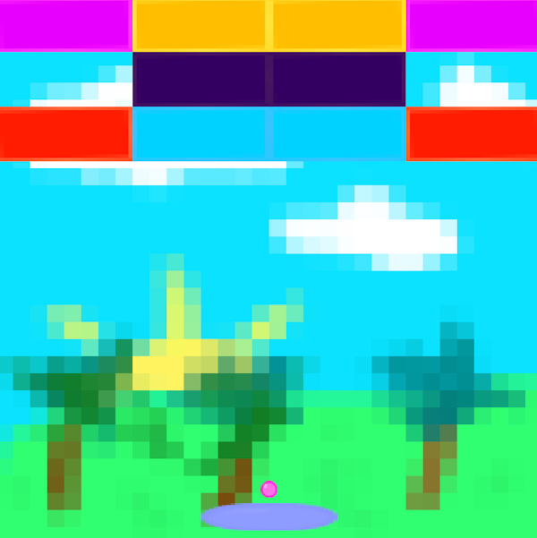

# Breakout

Classic breakout using OpenGL 3.3 with C++20.



## Prerequisties

- OpenGL 3.3 or higher
- GLFW 3.4 or higher
- C++20 compatible compiler
- CMake v3.15 or higher

## To make your custom level

To make a `n` by `m` level:

```lvl
n m
 T  ...  T
... ... ...
 T  ...  T
```

- `n` is a integer, $0 \lt n \leq 15$.
- `m` is a integer, $0 \lt n \leq 10$.
- `T` is a integer, $0 \leq n \leq 5$. Where $0$ indicates air (no tile).

A `4` by `3` level example:

```lvl
4 3
1 2 2 1
4 3 3 4
5 5 5 5
```

1. Follow the above format and place in `resources/levels` directory.
2. Manually `emplace_back` the c-string path relative from repository root to `_levels` in `Breakout.cpp`. E.g. `_levels.emplace_back("resources/levels/my_level.lvl)`
